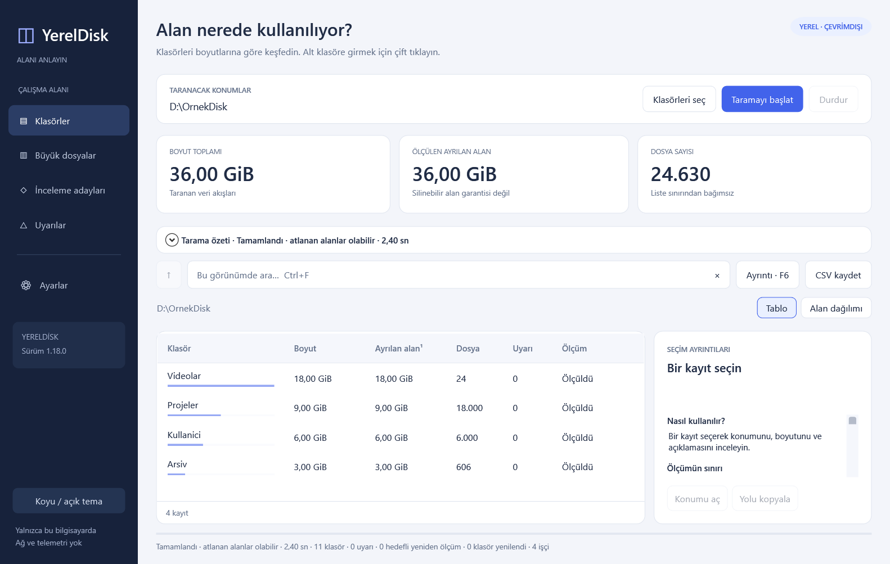
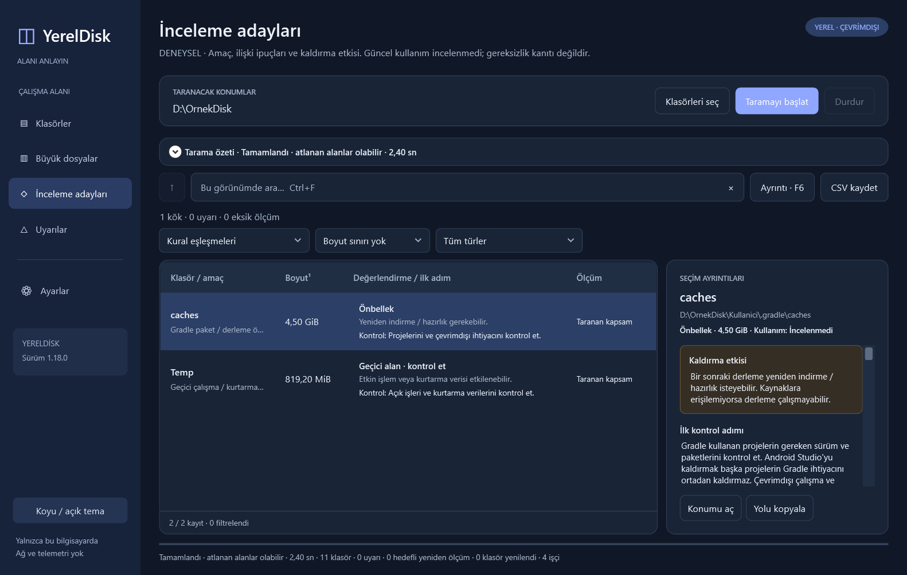

# YerelDisk

A local disk space analyzer for Windows. Find large folders and files, see how
space is distributed, and explore what recognized folders may be used for.
The interface is in Turkish. The app does not delete files automatically.

**[Download for Windows x64 → Releases](https://github.com/Cosmosprey/YerelDisk/releases/latest)**

## Download and run

1. Download **YerelDisk-1.18.0-win-x64.zip** from the Releases page.
   GitHub's **Source code** ZIP is for developers and requires a build.
2. Extract the **entire ZIP** to a folder.
3. Open **YerelDisk.exe**, choose the folders to scan, and start the scan.

The portable package includes the .NET runtime. You can run it without the SDK,
Visual Studio, PowerShell commands, or a separate .NET installation. Keep the
DLLs in the same folder as the EXE. The app runs with standard user permissions
and shows warnings for inaccessible folders. To remove it, close the app and
delete the folder where you extracted it.

The initial release targets **Windows 11 x64**. There are no native packages for
ARM64 or 32-bit Windows. macOS and Linux are unsupported. Other Windows versions
have not been separately verified. Windows may display an unknown publisher
warning because the app is unsigned. The SHA256 checksum on the release page
verifies download integrity. It does not provide a publisher signature.
You can leave your security software enabled.

## Features

- Select multiple folders and exclude specific subfolders from the scan.
- Browse folders and large files by size, with search, sorting, and a visual
  breakdown of disk usage.
- Scan metadata in parallel and refresh changed folders with a limited, targeted rescan.
- See logical sizes, measurable allocated space, and warnings for missing or
  partial measurements.
- **Review candidates** show clues based on known locations, structures, and
  types, along with a first check for each candidate. **Other large areas**
  lists measurable subtrees the app does not recognize.
- View details with **F6**, export CSV reports, switch between light and dark
  themes, and set preferences for the current session.
- Inspect local application records on request for **installation path matches**.





The screenshots use sample data in place of actual user files.
[Disk space distribution in the dark theme](docs/screenshots/distribution.png).

## Privacy and interpreting results safely

The app has no networking, telemetry, or automatic update code. A normal scan
inspects names, paths, sizes, timestamps, and file system metadata without
reading file contents. The app has no features for deleting or moving files
or changing permissions. It exports CSV files, uses the clipboard, and opens
Explorer only when you explicitly request those actions. It does not save
reports or settings automatically.

**Review candidates are experimental.** The app does not treat large or old
files as unnecessary. A folder match alone cannot establish whether data is in
use or safe to delete. Consider warnings about system data, installations,
shared stores, and personal data. Before deciding whether to delete anything,
check the details and review the relevant application's supported procedure.

Application record inspection is off by default. After a scan, use the button
for inspecting application records in Settings. It reads application names,
publishers, versions, and reported installation paths locally from the 32-bit
and 64-bit Uninstall entries in HKLM and the current user's HKCU. It may inspect
records outside the selected disk folders. The information is limited to the
current scan and session. Including it in CSV exports is a separate option
that is off by default. Copying the full F6 details also includes record clues
for the visible selection.

[Privacy and data scope](docs/PRIVACY.md) · [Measurement limits and usage](docs/USAGE.md)

## For developers

The C# / .NET 10 / WPF codebase has three projects and uses no external NuGet libraries.

```text
WPF              XAML, windows, and user interaction
  ↓
Application      scan flow, view models, queries, F6, and CSV
  ↓
Core             Windows metadata scanning, measurement, and review rules
```

Building on Windows x64 requires a .NET 10 SDK compatible with `global.json`
and the WindowsDesktop reference assemblies. The ready-to-run package requires
no SDK installation.

```powershell
.\Kaynak\Derle.cmd             # Small developer build that requires the runtime
.\Kaynak\Dogrula.cmd           # Normal suite with 866 checks
.\Kaynak\Dogrula.cmd -Native   # 117 checks that depend on environment capabilities
.\scripts\Publish.ps1          # Portable ZIP with the runtime included
```

The NuGet configuration for building and testing from source disables external
package sources. Preparing the portable package downloads Microsoft's runtime
packages from nuget.org the first time. The download takes place during
development, and the app runs offline.

[Build and packaging](docs/DEVELOPMENT.md) · [Test coverage](Dogrulama/Guncel/README.md)
· [Changelog](CHANGELOG.md)

## Development process and AI contribution

I developed this tool to address my own disk space needs. AI tools (Codex and
Claude) produced and helped develop much of the code and technical design.
I defined the requirements, guided the feature work, tried the app, and
provided feedback. I make no claim to having designed the architecture or
written all the code on my own.
Development included tests and independent agent reviews. They do not guarantee
that the app is bug-free or that data can generally be deleted safely.

## Summary

YerelDisk is a local Windows disk-space analyzer with a Turkish WPF interface.
Download the portable **win-x64 ZIP** from [Releases](https://github.com/Cosmosprey/YerelDisk/releases/latest),
extract the whole folder and run `YerelDisk.exe`. The release includes .NET.
You can run it without an SDK or a separate runtime installation. The initial
target is Windows 11 x64. There is no automatic deletion, telemetry or networking
in the app. Review suggestions offer experimental clues. Whether data is
unnecessary remains unverified. The code and technical design were developed with substantial
AI assistance. The project owner's role focused on requirements, priorities
and usage feedback.

## License

The YerelDisk source code is licensed under [MIT](LICENSE). The Microsoft .NET
components in the portable package ship with their own licenses and third-party
notices. Keep the package's `Lisanslar` folder.
