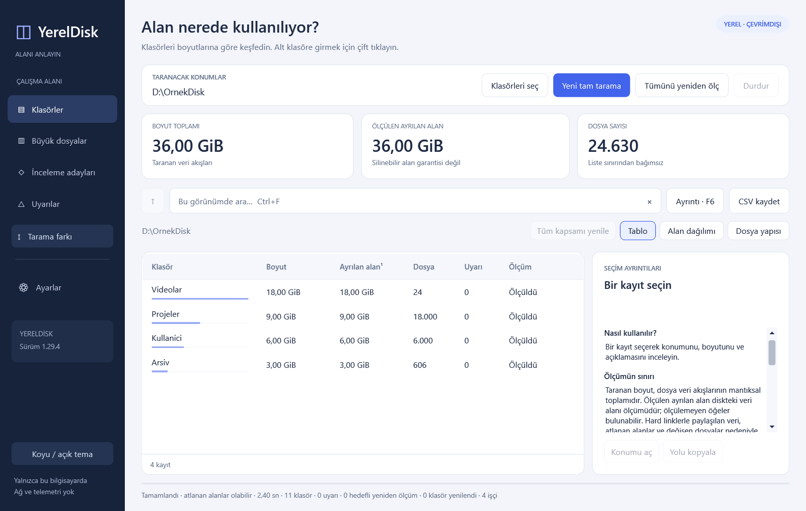
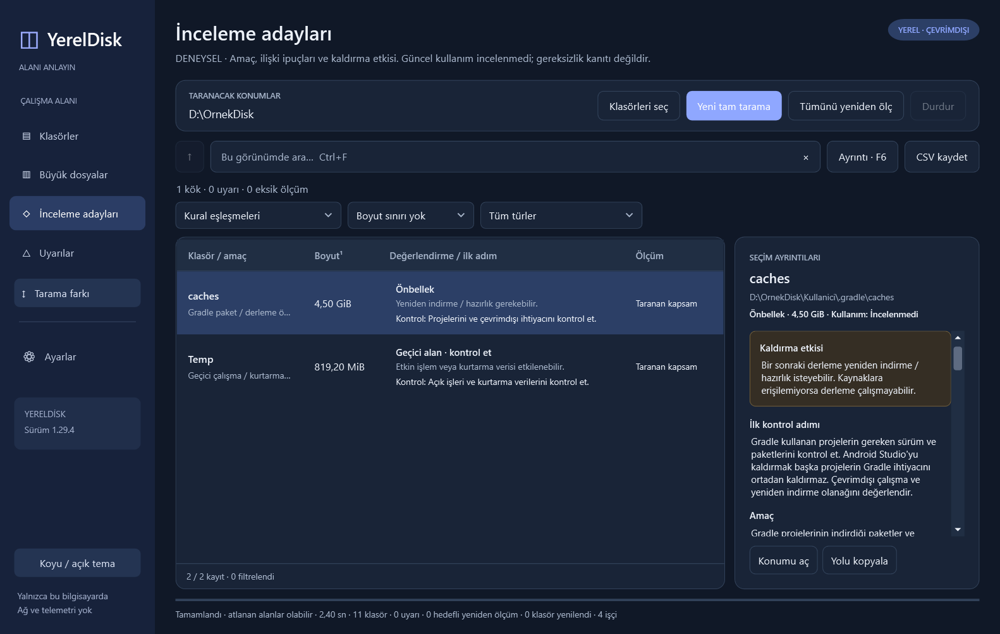

# YerelDisk

A local disk space analyzer for Windows. Find large folders and files, compare
folder measurements over time, and explore what recognized folders may contain.
**The interface is in Turkish. Review candidates are experimental.**

**[Download for Windows x64 → Releases](https://github.com/Cosmosprey/YerelDisk/releases/latest)**

Source changes do not automatically update an already downloaded app.
Download a new portable package to update it.

## Download and run

1. Download **YerelDisk-1.29.4-win-x64.zip** from Releases. GitHub's **Source code**
   ZIP is for developers and requires a build.
2. Extract the **entire ZIP** to a folder.
3. Open **YerelDisk.exe**, choose folders, and start a scan.

The portable package includes **.NET 10.0.15**. No SDK, Visual Studio, PowerShell
command, or separate runtime installation is required. Keep all package files
together. The app uses standard user permissions and reports inaccessible paths.

The verified target is **Windows 11 x64**. Other Windows versions, physical DPI
and multi-monitor configurations have limited verification. There are no native
ARM64, 32-bit Windows, macOS or Linux packages. The app is unsigned; Windows may
show an unknown-publisher warning. Leave security software enabled. SHA256 checks
download integrity and does not establish publisher identity.

## Features

- Select multiple local roots and exclude specific subfolders.
- Browse folders and retained large files with search, sorting, light/dark themes,
  and a disk-space distribution view. Unknown sizes stay below measured sizes.
- Scan metadata in parallel, with bounded verification and targeted repair of
  changes discovered during a scan.
- Save a compressed folder-measurement reference and compare a later scan of the
  same scope. Manage recent references and optionally remember a default folder.
  Comparisons track folder logical-size changes; they are not file-content diffs
  or a continuous background monitor.
- Reuse scan profiles containing roots and exclusions; remembering them is optional.
- Refresh a selected/open folder with an optional session-only metadata index.
  Unsafe or unavailable fast paths fall back to the original full scope with a
  reason. Older and refreshed areas have explicit measurement-time labels.
  At the root without a selected folder, refresh covers the whole original scope.
- Inspect experimental review clues, personal-data risks and first checks in
  the table and **F6** details. Unrecognized large areas remain explicitly unknown.
- Export the visible filtered/sorted rows to CSV and open locations in Explorer
  on request. The app has no cleanup commands for deleting scanned files.
- Inspect limited local application records on request for installation-path clues.





[Disk distribution in the dark theme](docs/screenshots/distribution.png).
Screenshots contain synthetic data rather than personal files.

## Privacy and interpreting results

The app has no networking, telemetry, accounts, or automatic updates. Normal
scans read names, paths, sizes, timestamps and file-system metadata without
reading file contents. File-system links and cloud placeholders are not followed.
CSV, clipboard, Explorer and reference-file actions require a user request.

Most preferences are session-only. Explicit **Remember** options can store scan
profiles and reference preferences locally. Loading a reference reads that
selected measurement file. References, CSV, preference files and copied details
can contain private paths; review them before sharing. [Privacy and data scope](docs/PRIVACY.md).

**A review match is not proof of non-use or safe deletion.** Large size, old age,
cache-like names, a missing installation record, or no observed personal-data
clue cannot establish that data is unnecessary. Check system/installation,
shared-store, offline-use and personal-data warnings and use the owning
application's supported management procedure.

Application record inspection starts off and runs only on request. It reads
limited Uninstall values from local HKLM/HKCU, possibly outside scan roots.
CSV inclusion is a separate opt-in. Full F6 copies include visible clues for the
selection. A path match does not prove installation or active use.

[Usage and measurement limits](docs/USAGE.md) · [Refresh behavior](docs/REFRESH.md)

## For developers

C# / .NET 10 / WPF, with no external NuGet library dependencies:

```text
WPF              XAML, windows, user interaction
  ↓
Application      scan flow, views, queries, references, profiles, F6, CSV
  ↓
Core             Windows metadata scanning, measurement, review rules
```

Use the SDK selected by `global.json` (10.0.404 or a later patch in that feature
band) and the WindowsDesktop references. The ready-to-run package needs no SDK.

```powershell
.\Kaynak\Derle.cmd             # Developer build; requires the desktop runtime
.\Kaynak\Dogrula.cmd           # Normal verification
.\Kaynak\Dogrula.cmd -Native   # NTFS/link/ACL capability-dependent checks
.\scripts\Publish.ps1          # Self-contained ZIP, including the runtime
```

Normal builds/tests disable external package sources. The explicit publish
command downloads Microsoft's runtime packs from nuget.org when missing.
Development downloads are separate from app activity. The published application
DLLs passed 1,591 Normal and 195 Native checks across 47 suites. Counts describe
checks, not independent use cases or real-world accuracy.
[Coverage and limits](Dogrulama/Guncel/README.md).

[Build and packaging](docs/DEVELOPMENT.md) · [Changelog](CHANGELOG.md)

## Development process and AI contribution

I developed this tool to address my own disk space needs. AI tools (Codex and
Claude) produced and helped develop much of the code and technical design.
I defined the requirements, guided the feature work, tried the app, and
provided feedback. I make no claim to having designed the architecture or
written all the code on my own.
Development included tests and independent agent reviews. They do not guarantee
that the app is bug-free or that data can generally be deleted safely.

## License

The source is licensed under [MIT](LICENSE). Distributed Microsoft .NET components
have their own licenses and notices. Keep the package's `Lisanslar` folder.
